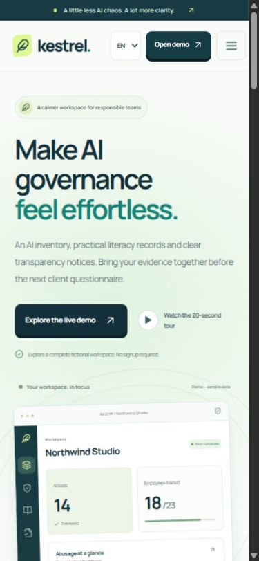
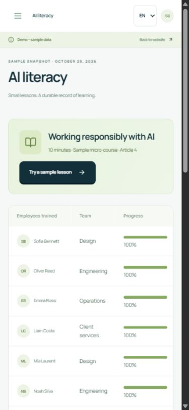
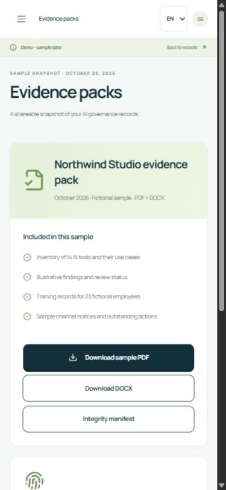

# Kestrel showcase

Public, independent landing page and interactive demo for an AI Act + GDPR evidence workspace.

The refreshed frontend uses the Quiet momentum visual system: petrol, water green, lime accents and locally hosted Manrope. It includes an interactive product walkthrough, currency display controls, mobile navigation, FAQs and a revised workspace dashboard. Reference choices and scope are documented in [DESIGN.md](docs/DESIGN.md).

**Demo – sample data.** Every company, person, tool, review and training record is fictional. The default workspace is Northwind Studio: 14 tools, 23 employees, 18 sample completions and 3 pending tool reviews.



## Run

Node.js 24 LTS is recommended.

```sh
npm ci
npm run dev
```

Open http://localhost:3000. For a static production build:

```sh
npm run typecheck
npm test
npm run check:boundary
npm run build
```

The deployable directory is `out/`. Webpack is selected explicitly for reproducible builds on Windows as well as Linux.

## Explore

- Landing with setup, company and agency prices in EUR and USD.
- Inventory CRUD, CSV preview/import, search and risk filters.
- Prewritten risk findings; there is no live classification engine here.
- Training register, a short sample lesson, quiz and browser-only acknowledgment.
- Chat, email and voice sample notices.
- Downloadable PDF, DOCX, generic sample certificate and integrity manifest.
- Client switching with separate local inventories and a brand preview.
- Role preview, local audit trail and reset.
- EN by default, with IT and ES interface translations. The public sample documents are in English.

Sample changes live in browser storage. No account is created. Do not enter real employee or client information. The downloadable pack is a fixed Northwind Studio snapshot; it does not incorporate browser edits.




The [visual tour](public/media/kestrel-tour.mp4) is a video assembled from actual product screenshots, not a recording of a live production customer session.

## Public boundary

This repository is self-contained. It has no dependency on the private application, production database, scoring rules, full question bank, prompts, document generator or payment account. The demo loads fictional inventory fixtures from a separate rate-limited Cloudflare Worker, with a bundled fallback if the endpoint is unavailable. All mutations remain browser-local.

Never configure production secrets here. `.env.example` contains only public demo configuration. `npm run check:boundary` checks tracked source candidates for private imports and common secret patterns; it complements, rather than replaces, a full secret scanner.

## Fictional seed and sample documents

```sh
npm run seed
python -m pip install reportlab python-docx
python scripts/generate-samples.py
```

The seed exports `public/samples/northwind-seed.json`. Document regeneration rebuilds the PDF, DOCX and generic certificate and recalculates the unsigned SHA-256 manifest. No private generator is used.

Verify a downloaded file's hash against `public/samples/manifest.json`. The public manifest is explicitly unsigned. Hashes detect changed bytes relative to the manifest; they do not independently authenticate an issuer.

## Deploy

See [DEPLOY.md](DEPLOY.md) for Cloudflare Pages and the optional Worker. See [QA.md](QA.md) for the scope and limitations of validation.

## Product and legal copy

The product organizes evidence and does not issue legal compliance certifications. Article 4 literacy measures and Article 50 applicability require attention to context, organizational role and the applicable law. A channel template is not an automatic legal determination. USD list prices are independent reference prices; the initial private checkout and fiscal invoice are in EUR from Italy.

## License

Copyright (c) 2026 Mariano Campuzano. All rights reserved.

No permission to reuse or redistribute this project is granted by its public availability. Third-party dependencies retain their own licenses.
